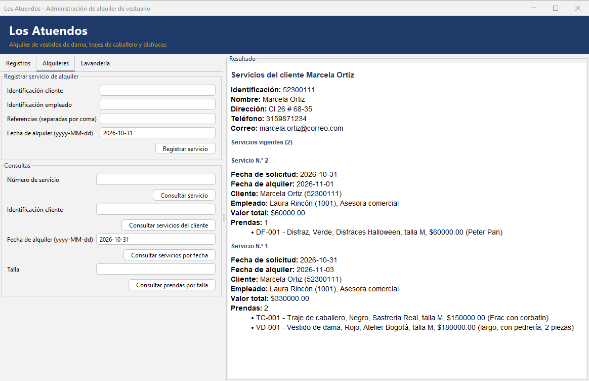

# Los Atuendos

Aplicación de escritorio para administrar el alquiler de vestidos de dama, trajes de caballero y disfraces.
Actividad 4 de Patrones de Diseño de Software, Fundación Universitaria Compensar (2026-2).

**Autor y grupo:** Christian Rey Mora López



## Cómo abrirla

- **NetBeans:** *File → Open Project*, seleccionar esta carpeta y ejecutar con *Run* (F6).
- **Sin NetBeans:** doble clic en `ejecutar.bat`, o desde una terminal:

  ```bash
  java -jar dist/LosAtuendos.jar
  ```

Requiere Java 11 o superior. La base de datos H2 se crea sola en `datos/` la primera vez, con datos de ejemplo:
clientes `52300111` y `80100222`, empleados `1001` y `1002`, prendas `VD-001`, `VD-002`, `TC-001`, `TC-002`, `DF-001` y `DF-002`.

## Patrones aplicados

| Patrón | Tipo | Dónde |
|---|---|---|
| Singleton | Creación | `persistencia.ConexionBD` |
| Factory Method | Creación | `fabrica.FabricaPrenda` y sus subclases |
| Builder | Creación | `modelo.ServicioAlquiler.Builder` |
| Composite | Estructural | `modelo.ComponenteAlquiler`, `Prenda`, `GrupoPrendas` |
| Facade | Estructural | `fachada.LosAtuendosFacade` |
| Decorator | Estructural | `lavanderia.DecoradorLavanderia` y sus subclases |
| Adapter | Estructural | `lavanderia.AdaptadorLavanderiaExterna` |
| Bridge | Estructural | `reporte.Reporte` y `reporte.FormatoSalida` |

El documento de diseño completo, con la justificación de cada patrón y los diagramas de clases y de secuencia,
está en [`docs/AA4_Diseño_ChristianReyMoraLopez.pdf`](docs/AA4_Diseño_ChristianReyMoraLopez.pdf).
El código Mermaid de los diagramas está en [`docs/diagramas`](docs/diagramas).

## Pruebas

`test/co/edu/ucompensar/losatuendos/PruebaFuncional.java` recorre todas las funcionalidades del enunciado contra una
base de datos en memoria (21 casos).

## Librerías

- [H2 Database 2.2.224](https://www.h2database.com): base de datos relacional embebida.
- [FlatLaf 3.5.4](https://www.formdev.com/flatlaf/): apariencia de la interfaz Swing.
